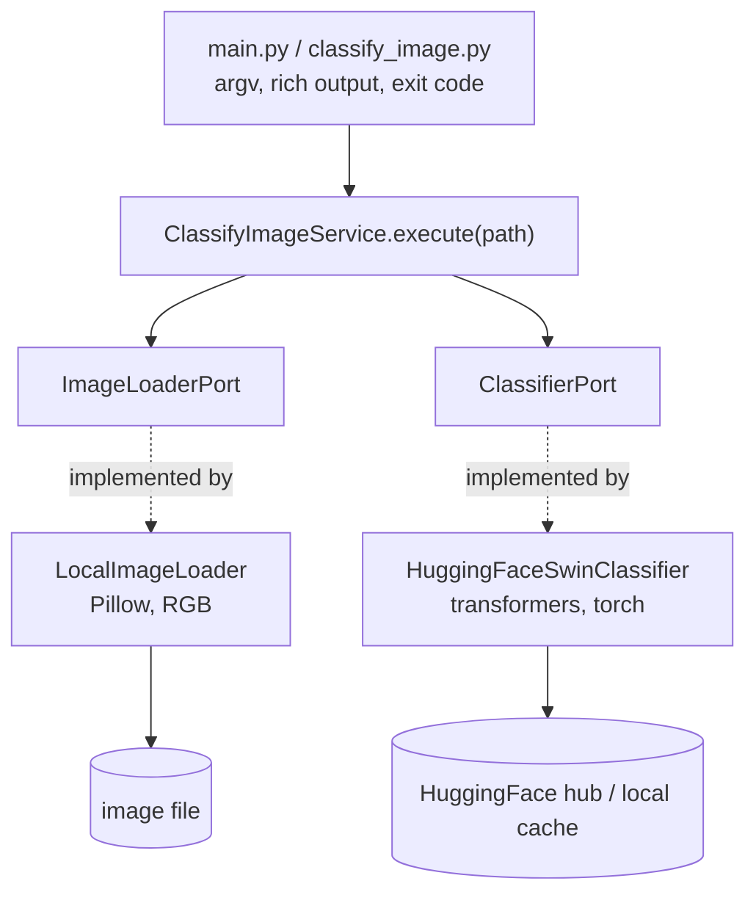

# swin-transformer — documentation hub

A command-line image classifier. It loads one image from disk, runs it through the
pretrained HuggingFace model `microsoft/swin-tiny-patch4-window7-224` and prints the
five most probable classes as a terminal table (`src/swin_classifier/main.py`,
`src/swin_classifier/infrastructure/hf_adapter.py:16`). The code is arranged as ports
and adapters with errors returned as `Result` values (`docs/architecture.md`). It grew
out of a course exercise whose brief is kept in [`task.md`](task.md); who else is meant
to use it is not stated anywhere in the repository.

The requirements reverse-engineered from the code are in [`../SPEC.md`](../SPEC.md).

## 1. Status

- **Branch documented:** `dev` at `c0c6d3a`. Last commit 2026-08-06 (`README.md` and
  `docs/quality-iso25010.md` only).
  Last commit touching the project's own code: `4f59921`, 2026-08-05 (benchmarks);
  `src/` was last changed in `ce89e3e`, 2026-08-05 (`git log`).
- **`dev` is behind the other long-lived branches.** `origin/release` and `origin/test`
  each carry 21 commits that are not in `dev`. On `release` they end in the merge of
  2026-11-07 "bring swin-transformer to revision 4.0.0" (`ce22786`, tagged `v1.1.0`);
  `test` has the same work without that merge, plus a changelog commit (`a0d9207`).
  They touch `src/swin_classifier/result.py` and `tests/` among 50 files. This document
  describes `dev` only.
- **Tests:** 28 test cases in `tests/` (5 + 5 + 5 + 1 + 12 across the five files) and
  5 benchmark cases in `benchmarks/`. One of the tests (`tests/test_perf.py`) needs the
  real model.
- **CI:** `.github/workflows/ci.yml` (lint, types, tests, secret scan, branch policy)
  and `.github/workflows/release.yml` (tag-triggered build). Whether the latest runs
  are green was not checked (no network access in this pass).
- **Evidently unfinished:** two helper scripts still point at the template's package
  (section 8); `ImageMetadata` is defined but unused
  (`src/swin_classifier/domain/models.py:21-28`); `docs/api/` predates the current
  `main()` (section 8).

## 2. Layout

| Path | What it is |
| --- | --- |
| `src/swin_classifier/main.py` | CLI shell: wires the adapters, renders the `rich` table, exits 1 on failure |
| `src/swin_classifier/application/classify_use_case.py` | `ClassifyImageService`: load, then classify |
| `src/swin_classifier/domain/interfaces.py` | `ClassifierPort`, `ImageLoaderPort` (`typing.Protocol`) |
| `src/swin_classifier/domain/models.py` | Frozen dataclasses `Prediction`, `ClassificationResult`, `ImageMetadata` |
| `src/swin_classifier/infrastructure/image_loader.py` | `LocalImageLoader`: Pillow, converts to RGB |
| `src/swin_classifier/infrastructure/hf_adapter.py` | `HuggingFaceSwinClassifier`: transformers + torch, top-5 softmax |
| `src/swin_classifier/result.py` | `Result[T, E]` value type |
| `classify_image.py` | Older entry point; adds `src/` to `sys.path` and calls `run_classification` |
| `tests/` | pytest suite (fakes for the ports, real files via `tmp_path`, one real-model test) |
| `benchmarks/test_pipeline_performance.py` | pytest-benchmark cases for loading and orchestration, model stubbed |
| `data/image.png` | Bundled sample image (1080 × 810, RGB), the CLI default |
| `docs/architecture.md`, `docs/quality-iso25010.md` | Author's design notes and ISO/IEC 25010 assessment |
| `docs/task.md` | Original course brief (Russian) |
| `docs/api/` | HTML API reference generated by pdoc 16.0.0 |
| `docs/screenshots/cli-output.png` | Image of a CLI run |
| `.agent/`, `workflow_prompts/`, `scratch/` | Vendored AI-agent kit and its prompt generator; not part of the program, excluded from lint (`pyproject.toml:49-50`, `docs/architecture.md:101-105`) |

## 3. Architecture

`main.py` constructs the two concrete adapters and injects them into the use case; it is
the only module in `src/` that names concrete classes (`src/swin_classifier/main.py:26-29`). The
use case depends only on the two Protocols (`classify_use_case.py:3,14`).



Data flow:

1. `main()` takes `sys.argv[1]` or `data/image.png` (`main.py:69-72`).
2. Construction of `HuggingFaceSwinClassifier` calls `from_pretrained` for the image
   processor and the model (`hf_adapter.py:21-22`). Per `docs/architecture.md:74-75`
   the weights are fetched from HuggingFace on first run and cached afterwards.
3. `execute()` converts the string to `Path` and calls the loader; a failed load is
   returned without calling the classifier (`classify_use_case.py:22-27`).
4. The loader returns `FileNotFoundError` for a missing path, otherwise opens the file
   with Pillow and converts it to RGB; any exception becomes a failure
   (`image_loader.py:17-24`).
5. The classifier preprocesses to PyTorch tensors, runs the model under
   `torch.no_grad()`, applies softmax and takes `torch.topk(..., 5)`; labels come from
   `model.config.id2label` (`hf_adapter.py:30-51`).
6. `main.py` prints a table and a "Winner" panel, or a "Classification Failed" panel
   and `sys.exit(1)` (`main.py:35-66`).

External dependencies at run time: the filesystem and the HuggingFace hub (or its local
cache). No GPU code path exists; there is no `.to(device)` anywhere in `src/`.

## 4. Build and run

Prerequisites (from `pyproject.toml`):

- Python `>=3.10` (`pyproject.toml:10`); CI tests 3.10 and 3.12 on Ubuntu and Windows
  (`.github/workflows/ci.yml:46-49`).
- Runtime: `transformers>=4.40`, `torch>=2.0`, `torchvision>=0.15`, `Pillow>=10.0`,
  `numpy>=1.24`, `rich>=13.0` (`pyproject.toml:18-25`).
- Network access to the HuggingFace hub on the first run (see step 2 above).

Install, as CI does (`.github/workflows/ci.yml:58-60`):

```bash
pip install torch torchvision --index-url https://download.pytorch.org/whl/cpu
pip install -e ".[dev]"
```

Or `pip install -e .` for runtime only (`README.md:128`), or
`python scripts/install_dependencies.py [--dev]` (`scripts/install_dependencies.py:3-4`).

Run (from the repository root, see section 8 about the default path):

```bash
swin-classify data/image.png      # README.md:129
swin-classify                     # README.md:130, uses data/image.png
python classify_image.py [path]   # README.md:63,68, works without installing the package
```

Release build, as `.github/workflows/release.yml:39` does it (needs the `release` extra,
`pyproject.toml:37`):

```bash
python scripts/build_release_artifact.py --version v1.0.0   # scripts/build_release_artifact.py:3
```

It writes `release/swin-classify[.exe]`, a zip with the executable, `README.md`,
`LICENSE` and `CHANGELOG.md`, and a `.sha256` per file
(`scripts/build_release_artifact.py:26-28,87-96,121-127`).

## 5. Configuration

The program reads no environment variables and no config file (no `os.environ`,
`getenv` or `argparse` in `src/` or `classify_image.py`).

| Setting | Where | Meaning | Default |
| --- | --- | --- | --- |
| First positional argument | `main.py:71`, `classify_image.py:12-14` | Path of the image to classify | `data/image.png`, relative to the current directory |
| `model_name` constructor argument | `hf_adapter.py:16` | HuggingFace model id; not exposed on the CLI | `microsoft/swin-tiny-patch4-window7-224` |
| Top-k | `hf_adapter.py:39` | Number of predictions returned; hard-coded | 5 |
| `[tool.coverage.report] fail_under` | `pyproject.toml:83` | Coverage floor for `pytest --cov` | 90 |
| `[tool.pytest.ini_options]` | `pyproject.toml:69-72` | `testpaths = ["tests"]`, `-q --strict-markers` | — |
| `[tool.ruff]`, `[tool.mypy]` | `pyproject.toml:45-67` | Line length 100, rule set, `strict = true` over `src` | — |

## 6. Usage

Classify the bundled sample from the repository root:

```bash
swin-classify
```

`README.md:35-50` shows the output for `data/image.png`: top label `ox` with score
0.5758, index 345. The table has the columns Rank, Label, Score (four decimals) and
Confidence Bar, which is `int(confidence * 20)` block characters (`main.py:49-57`).

Classify another file: `swin-classify path/to/photo.jpg`. A missing path prints
"Classification Failed" with `Image not found at: <path>` and exits 1
(`image_loader.py:18-19`, `main.py:35-43`). A non-image file or a directory takes the
same path with Pillow's error text (`image_loader.py:23-24`).

Use the pieces from Python, e.g. with a different loader or classifier: construct
`ClassifyImageService(loader, classifier)` with any objects that have
`load_from_path(Path)` and `classify(Image)` returning `Result`
(`domain/interfaces.py:17,34`); `tests/test_use_case.py:25-46` shows two such fakes.

## 7. Testing

```bash
pytest --cov --cov-report=term          # .github/workflows/ci.yml:62
pytest benchmarks --benchmark-only      # README.md:112
python scripts/collect_quality_metrics.py --output quality-report.json   # docs/quality-iso25010.md:11
```

`README.md:74` also gives `$env:PYTHONPATH='src'; python -m pytest tests/` for a
checkout without `pip install -e .` (`:79` runs `tests/test_perf.py -s` the same way).

| File | Covers | Needs |
| --- | --- | --- |
| `tests/test_use_case.py` (12) | Service happy path, short-circuit on load failure, propagation of classifier failure, `Result` semantics, frozen models | Pillow, numpy |
| `tests/test_image_loader.py` (5) | Real PNG, greyscale→RGB, missing file, text file, directory | Pillow, numpy |
| `tests/test_classifier.py` (5) | `Result` basics, missing file, `Prediction` fields | Pillow, numpy |
| `tests/test_main_shell.py` (5) | Table on success, exit 1 on both failures, argv handling; adapters monkeypatched | torch and transformers importable (imported by `main.py`) |
| `tests/test_perf.py` (1) | Real model classifies a random 224×224 image in under 1000 ms | Model download or cache |
| `benchmarks/test_pipeline_performance.py` (5) | Load time at 64/224/1024 px, missing-file path, use case with stubbed model | pytest-benchmark; not run by CI (`testpaths = ["tests"]`) |

Not covered: correctness of labels or ordering from the real model (also stated in
`docs/quality-iso25010.md:27-29`), `classify_image.py`, the UTF-8 stdout re-wrap.

## 8. Known limitations and problems

Behaviour:

- **Model-loading errors are not returned as `Result`.** `from_pretrained` runs in the
  constructor (`hf_adapter.py:21-22`), outside the `try` that starts at
  `hf_adapter.py:28`, and `main.py:28` does not catch it. A failed download therefore
  ends in a `rich` traceback with locals (`main.py:19`), not in the
  "Classification Failed" panel. This contradicts `README.md:14` ("no exceptions") and
  `docs/architecture.md:48-51`, which name "a model that will not download" as a
  returned failure.
- **Default path depends on the working directory.** `data/image.png` is a relative
  string (`main.py:71`); run elsewhere without an argument, the CLI reports the file as
  missing. The release zip does not include `data/image.png`
  (`scripts/build_release_artifact.py:91-95`).
- **No option parsing.** `--help` is treated as an image path; arguments after the
  first are ignored (`main.py:71`).
- Fixed top-5, one image per call, CPU only (`hf_adapter.py:39`;
  `docs/architecture.md:85-90`).
- The model is pinned by name, not by revision (`hf_adapter.py:16`;
  `docs/quality-iso25010.md:135-138`).
- `main.py:13-16,19` replaces `sys.stdout` and installs a global traceback hook at
  import time, which contradicts "holds no global state" in
  `docs/quality-iso25010.md:76`.

Packaging and tests:

- `requirements.txt` lists five packages without versions and omits `rich`, which
  `main.py:3-6` imports. The install line in `README.md:57` omits `torchvision`.
- `pytest` (also in CI, `ci.yml:62`, and before every release build,
  `release.yml:36`) runs `tests/test_perf.py`, which constructs the real classifier and
  so needs the HuggingFace hub or a warm cache.
- `docs/quality-iso25010.md:20` states 29 tests; the files at `c0c6d3a` contain 28.
- `docs/api/` was last regenerated in `5d60749` (2026-04-20); its `main.html` documents
  `run_classification` but not `main()`, added later.

Tooling text not adapted to this repository:

- `scripts/capture_usage_screenshots.py:131,173` runs `quality_template.cli` and
  `scripts/profile_application.py:22` imports `quality_template.core`; neither package
  exists here, so `README.md:122-123` ("Regenerate it with ...") does not hold.
- `SECURITY.md:14,18` names a gitleaks pre-commit hook and `requirements-dev.lock`;
  neither is in `.pre-commit-config.yaml` or the repository.
- `docs/branching.md:30-32` names `.github/workflows/branch-policy.yml` and a weekly run;
  on `dev` the check is the `branch-policy` job in `ci.yml:75-85`, run on push, pull
  request and manual dispatch, never on a schedule (`ci.yml:8-13`).
- `CONTRIBUTING.md:6-7` clones `repo-quality-template`, `:31` states an 85% floor
  (pyproject has 90), `:52` refers to `core.py`.
- `.pre-commit-config.yaml:4` pins ruff `v0.4.1`, while `pyproject.toml:32` requires
  `ruff>=0.6`. Its commit-msg hook (`.pre-commit-config.yaml:20-26`,
  `.agent/scripts/check_commit_msg.py:31`) demands `type(scope): Message.`, while
  `CONTRIBUTING.md` asks for `feat:`-style messages; recent commits follow the latter.

## 9. Repository tooling

The project carries an earlier, GitHub-hosted revision of
[repo-quality-template](https://github.com/IGORSVOLOHOVS/repo-quality-template). The
`README.md` on `dev` names no revision; the work that brings the repository to
revision 4.0.0 exists only on `origin/release` and `origin/test` (section 1).

Present on `dev`: `.github/workflows/ci.yml`, `.github/workflows/release.yml`,
`scripts/*.py`, `CONTRIBUTING.md`, `SECURITY.md`, `CHANGELOG.md`, `docs/branching.md`,
`docs/quality-iso25010.md`. Absent: `recipe.ps1` (so no `$App`/`$Provides`), `.claude/`,
`.gitea/`, `requirements-dev.lock`, `tools/wiki.py`.

Specific to this repository:

- `scripts/build_release_artifact.py:27-28`: `APP_NAME = "swin-classify"`,
  `ENTRY = src/swin_classifier/main.py`; built without `--windowed` (console app).
- CI installs CPU-only `torch`/`torchvision` from the PyTorch CPU index before
  `pip install -e ".[dev]"` (`ci.yml:32-34,58-60`; `release.yml` likewise).
- `scripts/enforce_branch_policy.py` is the older "exactly three branches" variant.
- `.pre-commit-config.yaml` is the project's own (ruff, basic hooks, commit-msg check
  from `.agent/scripts/`), not the template's.
- Not adapted: see the last group in section 8.

## 10. Related documents

- [`../README.md`](../README.md) — project README with example output and benchmark table
- [`../SPEC.md`](../SPEC.md) — requirements specification
- [`architecture.md`](architecture.md) — layering, error handling, deliberate omissions
- [`quality-iso25010.md`](quality-iso25010.md) — quality assessment
- [`branching.md`](branching.md) — branch policy
- [`task.md`](task.md) — original course brief
- [`api/index.html`](api/index.html) — generated API reference (stale, see section 8)
- [`../CHANGELOG.md`](../CHANGELOG.md), [`../CONTRIBUTING.md`](../CONTRIBUTING.md),
  [`../SECURITY.md`](../SECURITY.md), [`../LICENSE`](../LICENSE)

## 11. About this document

Written 2026-11-18 from commit `c0c6d3a` (branch `dev`).

Run to check it: `git ls-files`, `git log` (dates, branch and tag comparison),
`diff` of `scripts/` against the template clone, `python -m pytest --collect-only -q`
(collection of `test_main_shell.py` and `test_perf.py` fails here: `torch` is not
installed), and `python -m pytest tests/test_classifier.py tests/test_image_loader.py
tests/test_use_case.py` with `PYTHONPATH=src` on Python 3.13.3 — 22 passed.

Not run: `pip install`, `swin-classify` / `classify_image.py` (needs torch and a model
download), `tests/test_main_shell.py`, `tests/test_perf.py`, benchmarks, ruff, mypy,
the release build, and any check of CI status on GitHub. The benchmark and latency
figures quoted from `README.md` were not reproduced.
